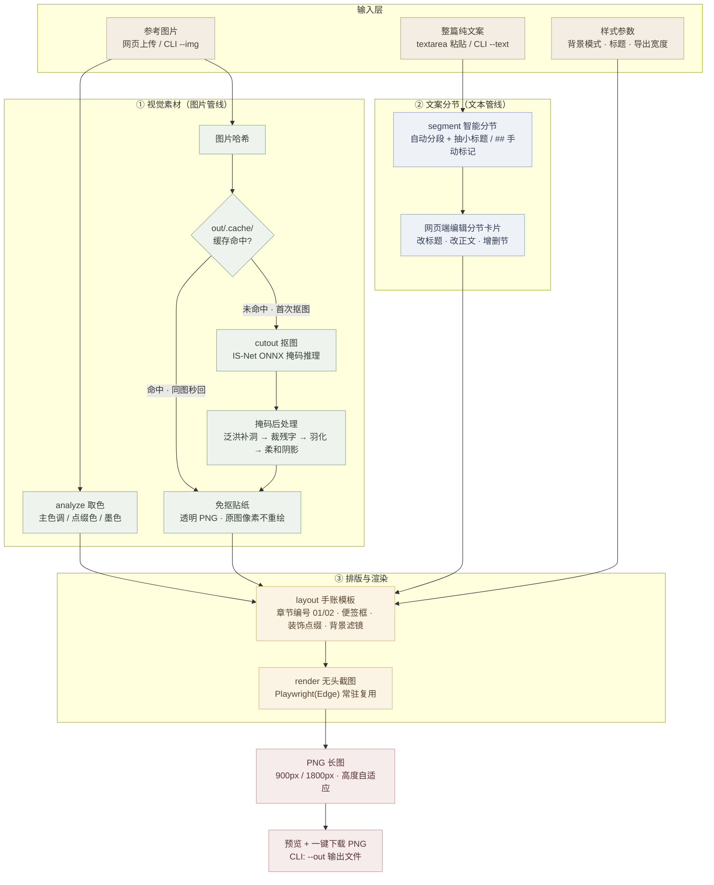

# 公众号手账长图 · 自动排版工具
> Handwritten-style Long Image Generator for WeChat Official Account

✅ 本地运行 · 图片与文案不上传云端  
✅ 参考图驱动配色与贴纸，**不使用文生图模型、不重绘原图主体**  
✅ 自动文案分节 + 可视化编辑分节卡片  
✅ 手账风竖版长图，固定宽度，一键导出 PNG  
✅ 同时支持网页可视化操作 + CLI 批量脚本调用

## ✨ 项目简介
公众号推文常用手账风格竖版长图，使用设计软件反复排版修改成本高；AI绘图方案文字错乱、样式不可复现、原图元素容易变形，且大多需要上传素材到第三方服务器。

本工具采用 **AI决策 + 确定性渲染** 的路线：
上传一张参考图作为视觉素材源，本地 ONNX 模型抠图提取装饰贴纸、自动提取整套配色；粘贴纯文本文案，自动拆分为章节，支持手动调整标题与正文；内部通过 HTML+CSS 组装手账排版，复用 Playwright 无头浏览器截图输出高清 PNG。

所有计算在本机完成，素材不会外发。适合公众号编辑、小红书图文、读书笔记手账批量出图。

## 🖼️ 效果预览
> 左侧上传参考图，右侧一键生成手账长图。生成内容、配色、贴纸全部继承参考图，文案自动分节填入。

| 输入 · 参考图 | 输出 · 手账长图 |
| --- | --- |
|  |  |

## 📸 核心特性
- 🛡️ **隐私优先**：全部本地运算，图片、文案不上传公网
- 🎨 **参考图驱动风格**：自动提取主色/点缀色/文字色，抠取原图主体作为手账贴纸
- 📝 **智能文案分节**：自动分段识别小标题；支持 `## 小标题` 手动标记，分节结果可编辑
- 🧩 **可交互排版预览**：网页端可视化修改每一节标题、正文，支持增删章节
- 🖼️ **背景多种模式**：原图模糊背景、渐变遮罩、颗粒胶片质感
- 📐 两种导出宽度：`900px`（公众号标准） / `1800px`（高清）
- ⚡ 缓存加速：抠图结果按图片哈希缓存，同图重复生成秒出
- 🧰 双入口：网页可视化界面 + CLI 命令行批量生成
- 🧠 抠图模型：`IS-Net (rembg)` ONNX 本地推理

## 🚀 快速开始
### 前置依赖
- Node.js ≥ 18
- Edge 浏览器（Playwright 依赖，首次运行会自动安装）
- 建议配置：8G 以上内存，CPU 即可运行（不需要显卡）

### 1. 安装依赖
```bash
npm install
```

### 2. 启动网页服务
```bash
npm run serve
```
启动成功后访问：
```
http://127.0.0.1:5399
```
> 服务启动阶段会自动预热 ONNX 模型与无头浏览器，首次启动会有短暂等待。

### 3. 网页端使用流程
| 步骤 | 操作 | 说明 |
|---|---|---|
| 01 | 上传参考图片 | 拖拽或点击上传，决定整体色调与手账贴纸素材，本地自动抠图 |
| 02 | 粘贴整篇文案 | 在文本框粘贴纯文字，点击【智能分节】；可使用 `## 小标题` 手动标记章节 |
| 03 | 调整样式与尺寸 | 选择背景模式、封面标题、导出宽度 |
| 04 | 编辑分节卡片 | 右侧面板修改标题、正文，自由新增、删除章节 |
| 05 | 生成并导出 | 点击【生成公众号长图】，预览后一键下载 PNG |

### 4. CLI 命令行使用（批量生成）
```bash
node src/pipeline.mjs --img 参考图.png --text 文案.txt --title 封面标题 --out out/result.png
```
适合脚本批量生成、自动化工作流接入。

## 🧬 管线原理（Pipeline）


1. **analyze.mjs**：降采样图像聚类取色，输出主色调、点缀色、正文墨色，后续样式自动适配
2. **cutout.mjs**：IS-Net ONNX 推理得到掩码，经过补洞、去噪、边缘羽化、阴影合成生成贴纸；图片哈希缓存避免重复推理
3. **segment.mjs**：支持自动语义分段 + Markdown `##` 标记两种模式，输出结构化章节数组
4. **layout.mjs**：基于配色、贴纸、章节数据渲染手账页面 HTML，包含便签框、章节编号、装饰布局、背景滤镜
5. **render.mjs**：复用常驻 Edge 实例渲染页面，长图截图输出 PNG

> 核心原则：模型只生成掩码，**原图像素内容不重绘、不变形**；排版由 CSS 确定性控制，规避文生图文字崩坏问题。

## ⏱️ 性能参考（2026-02 更新）
| 场景 | 耗时 |
|---|---|
| 同一张图再次生成（缓存命中） | ~1.5–2 s |
| 快速模式（跳过抠图，内置装饰） | ~1.5–2 s |
| 全新图片 + 精细抠图（首次） | ~5.5–7.7 s |
| 1800px 高清导出 | 在原有基础上额外 +5–6 s |

提速方案：
- ONNX 模型服务启动时加载一次，常驻内存
- 无头浏览器实例常驻复用，避免反复拉起
- 抠图结果持久化缓存到 `out/.cache/`
- 启动预热模型与浏览器资源
- 全链路耗时埋点日志输出，方便调试性能瓶颈

## 📁 项目文件结构
```
├── src/
│   ├── server.mjs      # Web服务入口，提供静态页面与接口
│   ├── pipeline.mjs    # 核心管线，网页与CLI共用
│   ├── analyze.mjs     # 图片配色提取
│   ├── cutout.mjs      # ONNX抠图与贴纸后处理
│   ├── segment.mjs     # 文案分节逻辑
│   ├── layout.mjs      # 手账HTML/CSS模板组装
│   └── render.mjs      # Playwright无头截图导出
├── public/
│   └── index.html      # 前端交互页面
├── models/
│   └── isnet-general-use.onnx   # rembg IS-Net抠图模型
├── assets/
│   ├── 输入-参考图.png      # 效果预览：输入参考图
│   └── 输出-手账长图.png    # 效果预览：输出长图
├── out/
│   ├── .cache/         # 抠图贴纸缓存目录
│   └── 生成结果图片
├── package.json
└── README.md
```

## ⚙️ 接口说明（Web API）
后端内置两个核心接口，前端通过接口和管线交互：
1. `/api/segment`：接收文本，返回分节结果，用于提前编辑章节
2. `/api/generate`：接收分节数据、图片缓存ID、样式参数，执行完整渲染管线，返回预览/下载地址

## 📌 已知局限 & 设计取舍
- 不使用文生图模型：规避文字乱码、排版失控，但贴纸只能来自你上传的参考图
- 依赖 Edge 浏览器截图：文字渲染效果稳定，但首次会自动安装浏览器
- 贴纸摆放为可控随机：装饰数量做了上限，不会过度堆砌；如需完全固定布局，需要修改 layout 模块
- 暂不支持多图混合作为素材源，一次仅使用一张参考图

## 🛠️ 开发与二次开发
- 修改手账样式：调整 `layout.mjs` 内部 CSS 模板、字体、便签样式、装饰元素
- 替换抠图模型：替换 `models/` 下 ONNX 文件，同步修改 cutout.mjs 推理参数
- 新增导出格式：在 render.mjs 增加导出逻辑
- 增加更多背景滤镜、装饰组件：扩展 layout 层

## 📄 开源声明
> 本项目仅用于个人学习、非商用图文制作。
> isnet-general-use.onnx 模型来自 rembg 项目，请遵循模型对应的开源协议。

## 💡 建议
日常公众号使用优先选择 **900px**；1800px 高清适合印刷、长图海报，生成耗时明显增加。
